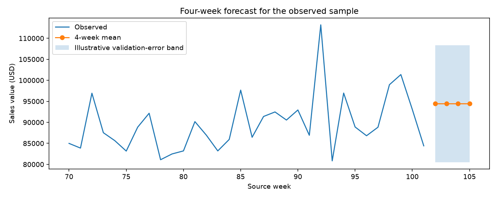

# Retail Customer 360 & CRM Segmentation

A portfolio analysis of grocery purchase behaviour and budget-aware CRM targeting using dunnhumby The Complete Journey.

## Business question and current boundary

Which households should receive which coupons to encourage additional purchases without subsidising purchases that would happen anyway?

The main analysis currently provides validated purchase metrics, aggregate category/discount exploration, interpretable RFM, a no-purchase forecast and **audience selection for one hypothetical USD 2 offer**. It also forecasts weekly retailer proceeds for the observed household sample. It does not estimate causal coupon uplift or report realised campaign profit. A separate [optional recommendation experiment](additional/notebooks/03_coupon_recommendation_experiment.ipynb) ranks actual historical coupons for TypeB/TypeC recipients and evaluates future product relevance. It does not change the main USD 2 audience-selection policy.

## Main reading order

| Notebook | Business purpose |
|---|---|
| [01 Data understanding](notebooks/01_data_understanding.ipynb) | Validate source files, keys, missingness, receipt relationships and time coverage |
| [02 Customer metrics](notebooks/02_customer_metrics.ipynb) | Understand purchase frequency, sales, basket value, repeat purchases and concentration |
| [03 Categories and discounts](notebooks/03_categories_and_discounts.ipynb) | Explore category sales/reach and discount use; no placement-file dependency |
| [04 RFM segments](notebooks/04_rfm_segments.ipynb) | Describe households with simple, explainable purchase-history segments |
| [05 No-purchase prediction](notebooks/05_no_purchase_prediction.ipynb) | Compare chronological baselines/models; risk is not coupon responsiveness |
| [06 CRM scenarios](notebooks/06_crm_campaign_scenarios.ipynb) | Select a budget-constrained audience for a single assumed offer and examine sensitivity |
| [07 Weekly sales forecasting](notebooks/07_weekly_sales_forecast.ipynb) | Compare four-week forecasts using rolling validation and a later test |

Start with the [focused results](reports/project_results.md) and [main chart gallery](reports/visual_findings.md). See the [model card](docs/model_card.md) and [experiment plan](docs/crm_experiment_plan.md) for limitations.

## Weekly sales forecast

The [forecast notebook](notebooks/07_weekly_sales_forecast.ipynb) aggregates recorded
`SALES_VALUE` by source week and compares last-week, four-week average and simple
exponential smoothing forecasts. Four rolling validation origins select the model;
five later origins evaluate it. The four-week average was selected, with test MAE
of USD 5,337 and WAPE of 5.91% on this historical sample. These errors describe
repeated four-week forecasts, not causal campaign impact or a guarantee of future
accuracy. The plot's validation-error band is illustrative, not a calibrated
prediction interval. Source weeks 1 and 102 are incomplete; the final forecast is
as of the end of week 101, so week 102 is already partially observed in the raw
data. Results apply only to the recorded households, not all store sales. Calendar
dates are unverified and annual seasonality is not estimated.



## Additional analysis

The [additional/ folder](additional/README.md) preserves retention/cohorts, K-Means, contribution-value scenarios, product placements, extended reports and the earlier broad dashboard plans. These are supporting exploration, not required steps in the main reading path. The optional coupon notebook is an offline relevance prototype, not a causal coupon-response or profit model. Their exclusion from the main story does not discard the work.

The optional coupon experiment also has an executed [Pandas version](additional/notebooks/04_coupon_recommendation_pandas.ipynb) with matching recommendations and a [SQL/Pandas benchmark](additional/reports/coupon_pandas_benchmark.md).

## Dashboards

The focused [Power BI plan](powerbi/dashboard_plan.md) and [Tableau plan](tableau/dashboard_plan.md) describe manual builds with the existing exports. No workbook has been built or published. Optional retention/cluster/value pages are in the archived full plans under additional/.

## Reproduce locally

Use Python 3.12 and the setup in [docs/reproduce.md](docs/reproduce.md). With source CSVs and the project environment ready:

```powershell
.venv/Scripts/python.exe scripts/run_pipeline.py
```

The existing technical refresh still computes both main and supplementary datasets for compatibility with the BI export package. The reading structure is shortened; the pipeline has not been rewritten as a coupon recommender. Parameters are in [config/project.json](config/project.json), refresh behaviour in [automation.md](docs/automation.md), and BI table grains in the [data contract](docs/dashboard_data_contract.md).

All source/derived data, CRM targets, model files and BI CSVs remain local under Git-ignored `data/`. No customer has been contacted and no campaign launched.

## Data

Download [dunnhumby - The Complete Journey on Kaggle](https://www.kaggle.com/datasets/frtgnn/dunnhumby-the-complete-journey); see the [original publisher](https://www.dunnhumby.com/source-files/) for context. Review source usage terms before redistributing any data or extract.

Create `data/raw/` and place the original unpacked CSVs directly in it:

```text
campaign_desc.csv
campaign_table.csv
causal_data.csv
coupon.csv
coupon_redempt.csv
hh_demographic.csv
product.csv
transaction_data.csv
```

The complete audit inventories all eight files. The main category/discount notebook uses transaction_data and product only; supplementary placements use causal_data. Column meanings are in the [data dictionary](docs/data_dictionary.md).

## Next business milestone

The optional notebook now compares household product-history ranking with population popularity on known historical TypeB/TypeC recipients. Next, validate full offer terms and economics, improve cold-start/diversity handling, and design a prospective household-randomised test. Coupon costs and additional purchase effects require validated assumptions or experimental data. TypeA individual coupon allocations are not observed; redemption is not itself proof of incremental sales.
