# Retail Customer 360 - results through stage 6

> Supplementary material preserved from the broader project. Original scope/output-path descriptions below are historical context. Use the main README for the focused business boundary and additional/README.md for current notebook locations.

This is a portfolio analysis on a fixed source panel, with local reproducible code. Analytics, predictive modelling, scenario CRM selection and the refresh pipeline have been executed. Power BI and Tableau are detailed implementation plans with data exports, not built or published dashboards.

## Deliverables by original project stage

| Stage | Delivered | Evidence |
|---|---|---|
| 1 SQL and preparation | Eight-file audit, dictionary, eligibility rules, exact-cent paid-basket/customer metrics, product/campaign BI model | Notebooks 01-03; sql/; source dictionary |
| 2 Customer analytics | RFM, first-observed cohorts, repeat-period retention, assumption-based contribution scenario | Notebook 04 |
| 3 Machine learning | K-Means comparison; constant/recency/logistic/Random Forest forecasting with chronological validation/test | Notebooks 04-05 |
| 4 Dashboards | Separate implementable Power BI and Tableau plans, formulas, filter scopes, QA and actual CSV exports | powerbi/dashboard_plan.md; tableau/dashboard_plan.md; dashboard data contract |
| 5 CRM selection | Hard-budget target selection, margin/uplift sensitivity, alternative policies and randomised pilot design | Notebook 06; crm module; experiment plan |
| 6 Automation | One-command local refresh of metrics, segments, model scores, target audience and BI tables, with source hashes | scripts/run_pipeline.py; automation guide |

## Customer analytics

Latest snapshot source day 711; RFM lookback 180 days. Segments contain 2,500 households. K-Means chose K=2 by silhouette; seed adjusted Rand stability 1.0000. Cluster names have not been invented. CLV-style output is a six-month contribution scenario with assumed margin/survival; true lifetime value is not identified.

| Segment | Households | Last-180-day eligible sales (USD) |
|---|---:|---:|
| At risk | 37 | 27,774.80 |
| Champions | 531 | 1,151,608.39 |
| Hibernating | 167 | 8,608.54 |
| Loyal | 323 | 399,185.23 |
| Occasional | 1,277 | 672,420.15 |
| Potential loyalists | 165 | 54,514.21 |

## Frozen predictive evaluation

Selected on validation: random_forest. On 9,670 held-out household snapshots, AP=0.5446, ROC AUC=0.8731, Brier=0.0974. Recency baseline AP=0.4889; prevalence=0.1619. Repeated snapshots are forecasting known households, not independent people. Deployment refitting does not replace these frozen test results.

## CRM scenario, not measured campaign impact

Defaults: assumed uplift 10 percentage points, margin 25%, discount USD 2, contact USD 0.05, budget USD 250.00. Selected 91 households; maximum reserved cost USD 186.55; expected offer cost USD 111.66; scenario incremental contribution USD 74.92. These are assumption-dependent planning figures, not realised profit, experimentally estimated uplift, or a sent campaign. No-offer control and real margin data are needed to validate the decision.

## Figures

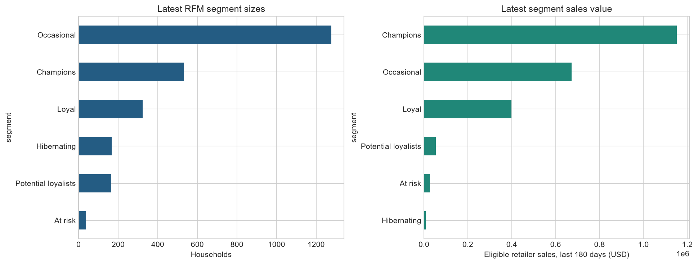

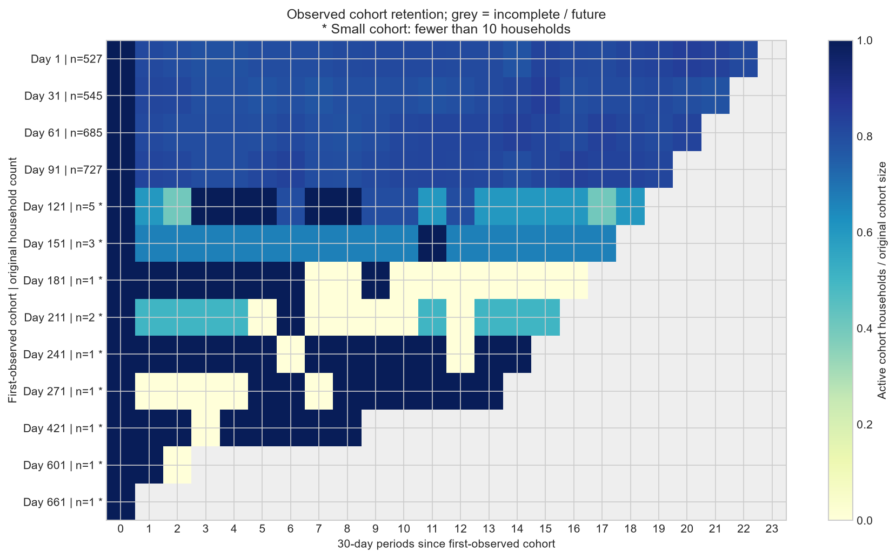

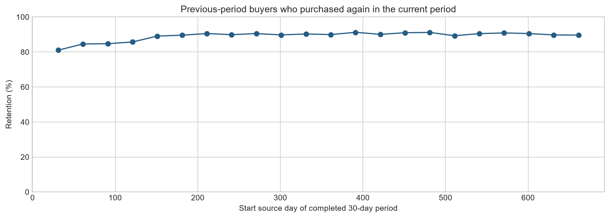

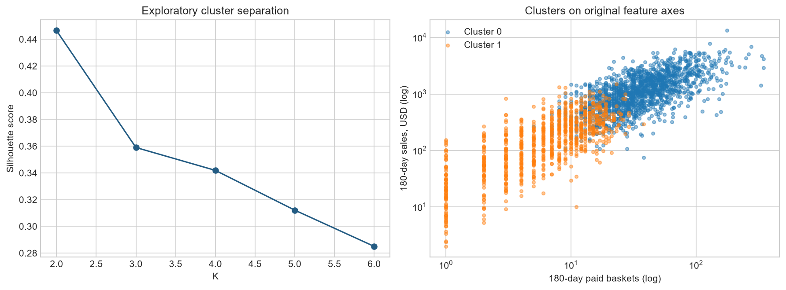

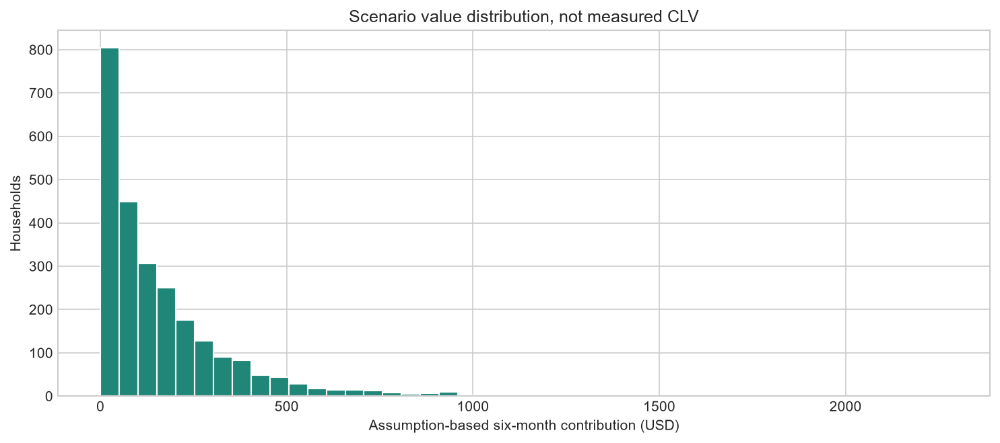

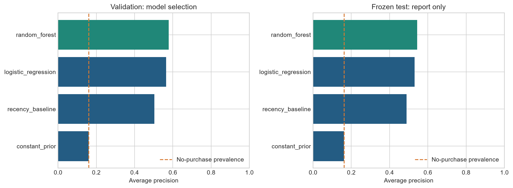

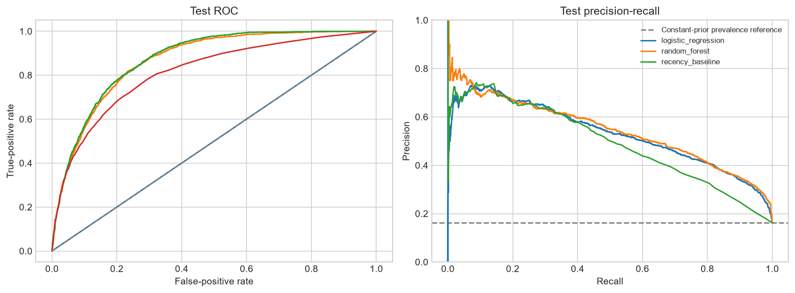

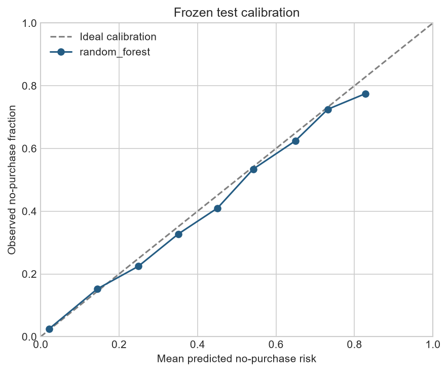

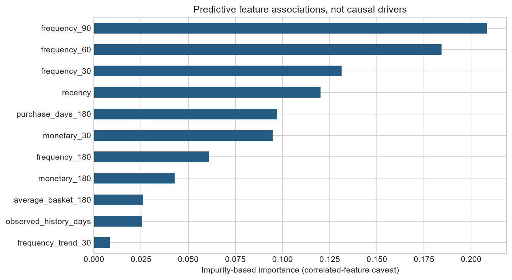

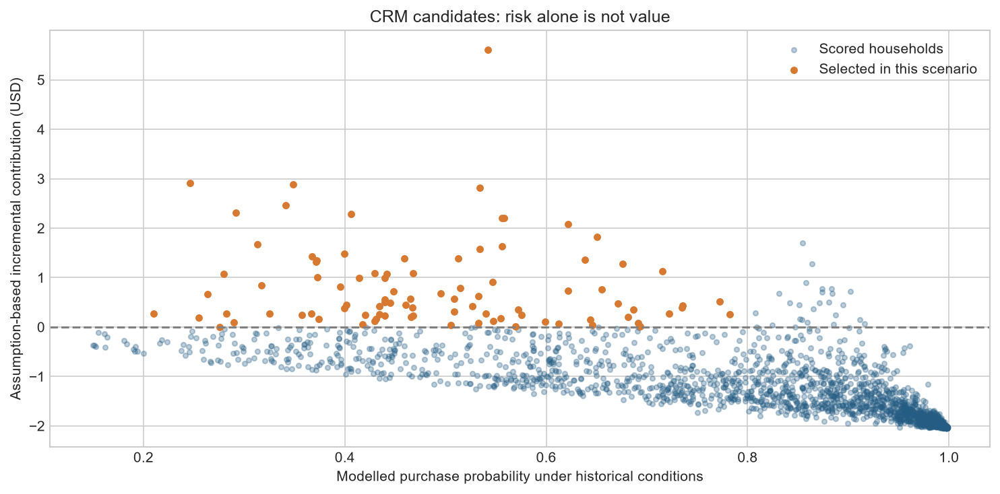

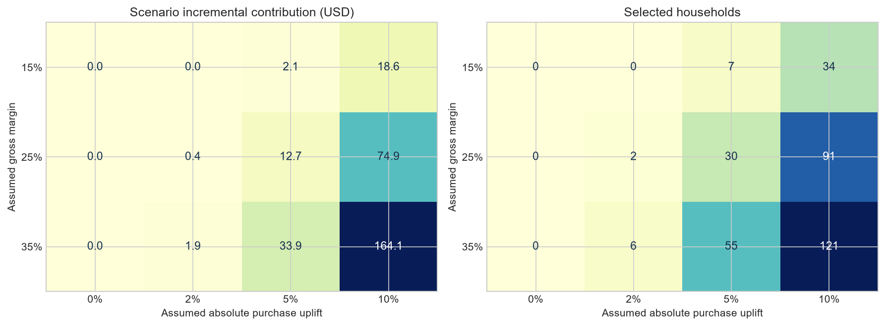

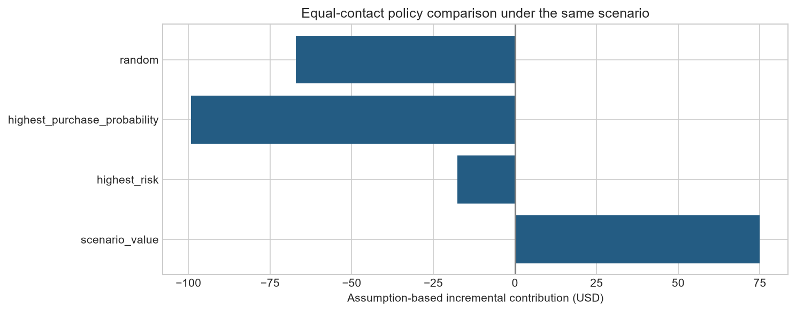

## Practical next steps

Implement the dashboard plans manually and check numbers against exported files. Review dataset publication terms before uploading any Tableau extract. Add real portfolio links only after building and testing the workbooks. A real CRM deployment requires experimental response and margin validation; it is outside the executed local portfolio scope.
