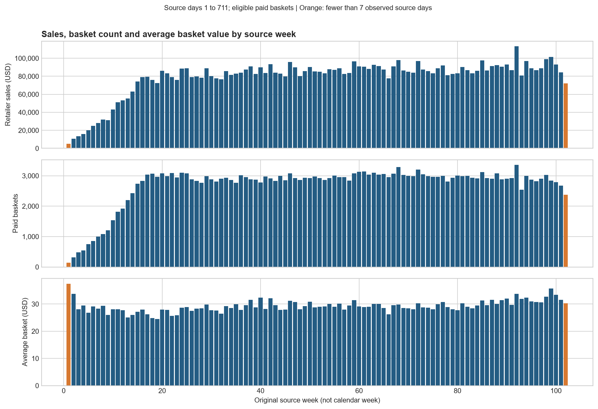
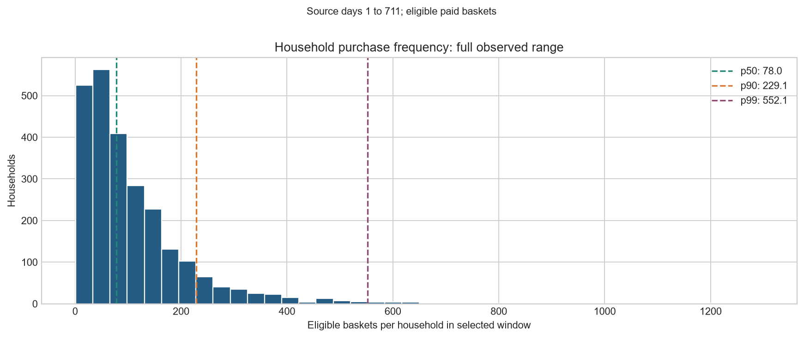
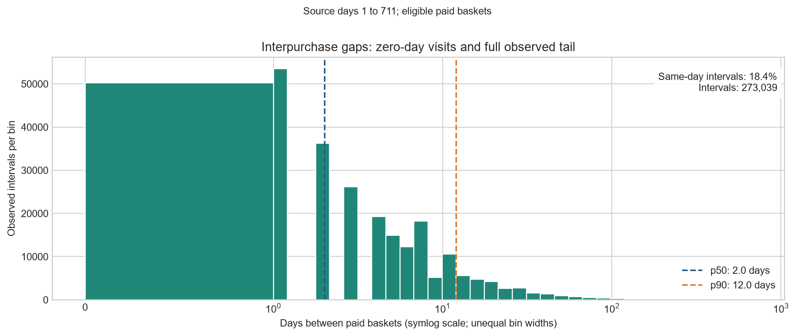
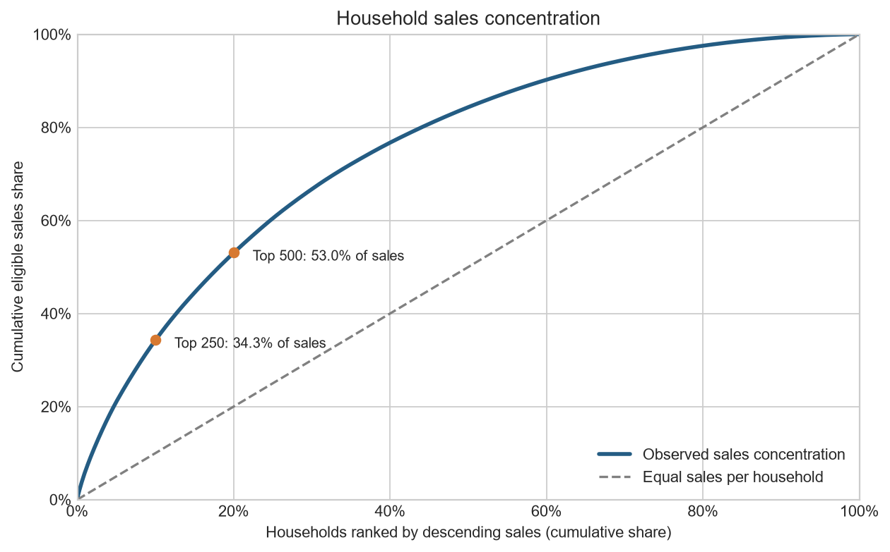
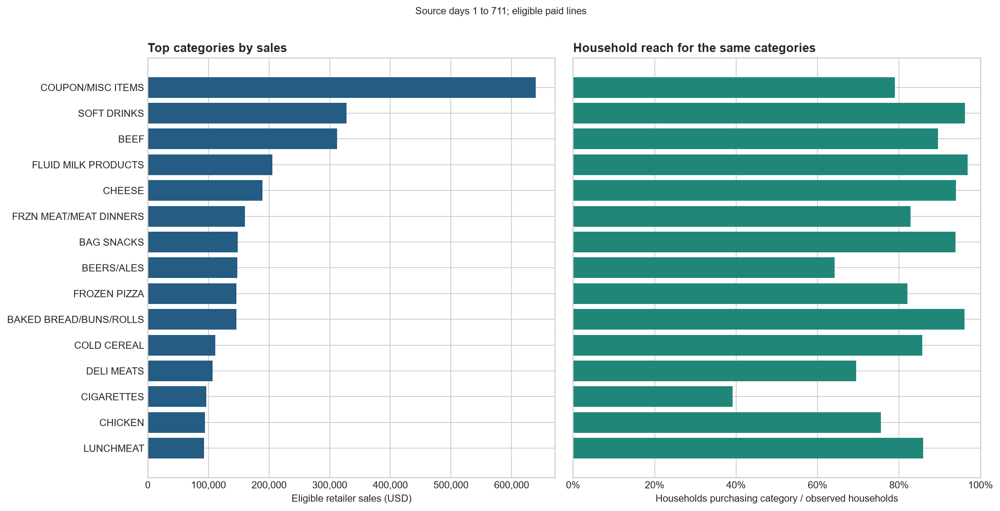
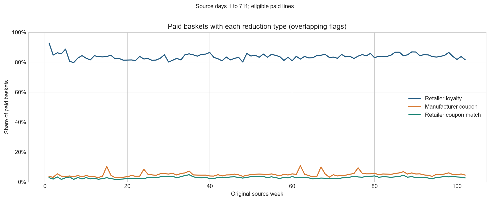
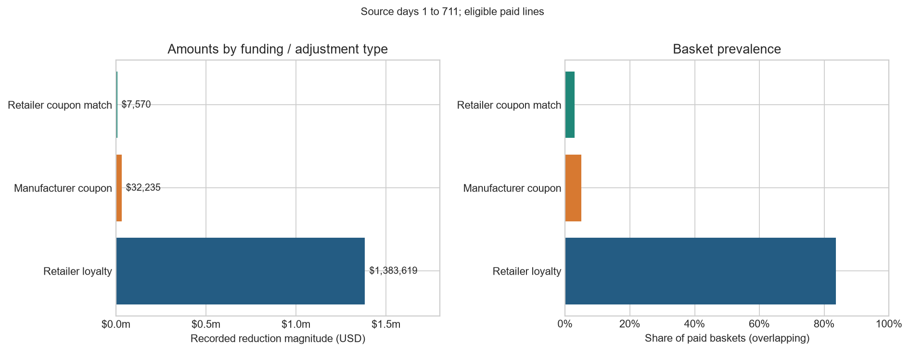
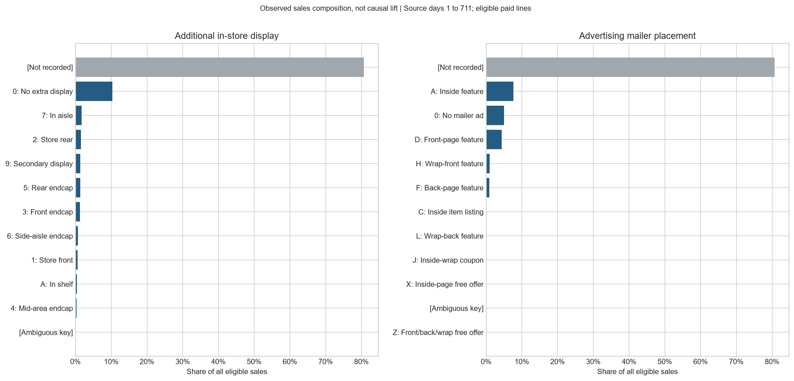

# Visual exploration: household behaviour, sales mix and promotions

> Supplementary material preserved from the broader project. Original scope/output-path descriptions below are historical context. Use the main README for the focused business boundary and additional/README.md for current notebook locations.

Snapshot: source days 1 to 711, using positive-quantity, positive-sales lines. These are descriptive results, not experimental campaign effects. All eight charts are generated by the executed notebooks; local aggregate datasets remain excluded from Git.

## Household and time patterns

- Median household frequency is 78 paid baskets across the full window; the mean is higher because the distribution is right-skewed.
- The highest-spending 250 households (10%) account for 34.29% of eligible sales; the highest-spending 500 (20%) account for 53.05%.
- Weekly totals show a source-period ramp-up. Calendar seasonality, acquisition, or marketing impact cannot be inferred from that pattern alone. Edge weeks with fewer than seven observed days are marked separately.
- Consecutive-basket gaps include same-day receipts and exclude intervals across observation boundaries. These are not churn probabilities.

## Categories and discounts

- The largest source category is `COUPON/MISC ITEMS`, contributing 7.94% of eligible sales. Mixed source labels need investigation before merchandising interpretation.
- Household category reach overlaps across categories. The chart is a top-15 view; complete aggregate tables are generated locally.
- Discount basket flags overlap. Negative signed adjustments are presented as reduction magnitudes; positive adjustments are reported separately. Manufacturer-funded and retailer-funded reductions are distinct concepts and not a single retailer campaign cost.

## Promotional placement coverage

- Only keys needed by eligible purchases are audited: 2,355,132 product-store-week combinations.
- 614 relevant keys have duplicate promotion records. They are labelled ambiguous, not deduplicated silently or joined one-to-many.
- 80.67% of eligible sales have no matching promotion record. Missing records are **not** an untreated control group or explicit placement code `0`.
- Exact SQL sales and line counts reconcile before and after the placement join.
- Placement charts describe sales composition for purchased products. They omit promotion keys with zero purchases, and cannot measure lift, conversion, or the effect of relocating a product.

## Reproduction

Run [notebook 02](../../notebooks/02_customer_metrics.ipynb) and [notebook 03](../../notebooks/03_categories_and_discounts.ipynb) with the project interpreter. See [instructions](../../docs/reproduce.md) and [EDA methodology](../../docs/sales_promotions_eda.md). PNG figures are saved under `reports/figures/`; local aggregate tables under `data/processed/eda/`.
