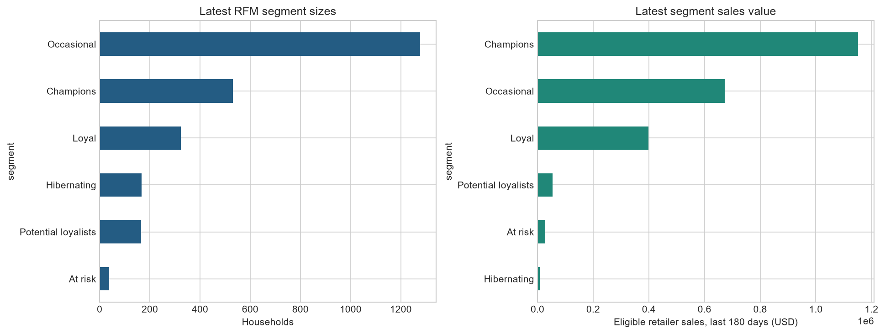
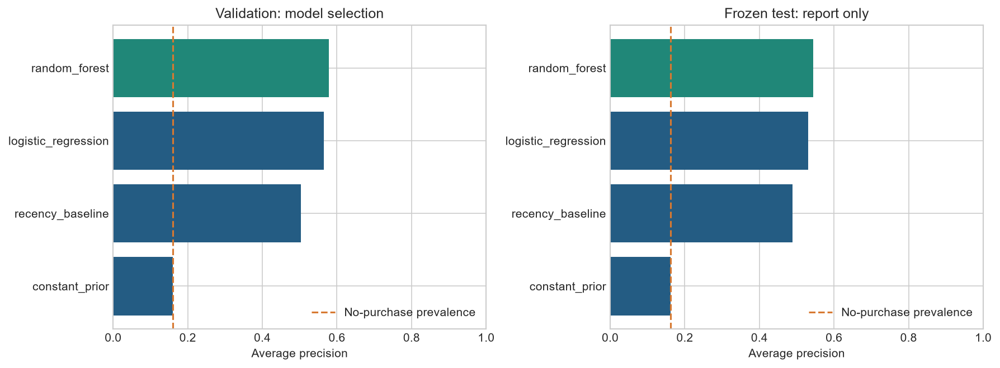
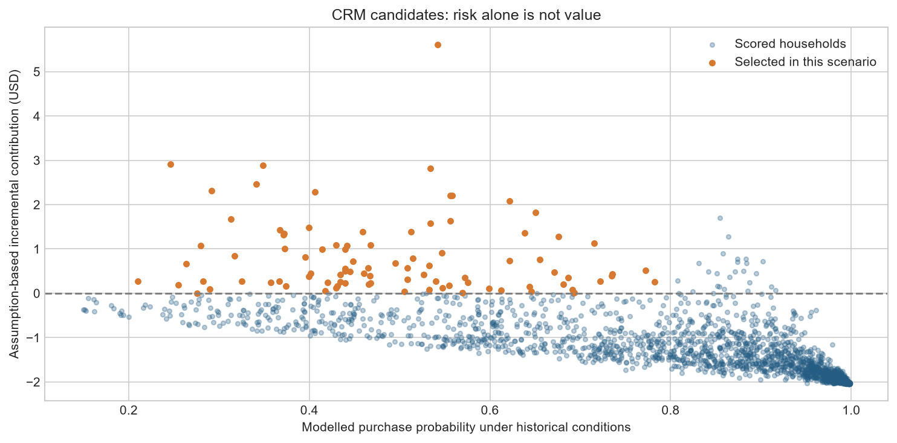
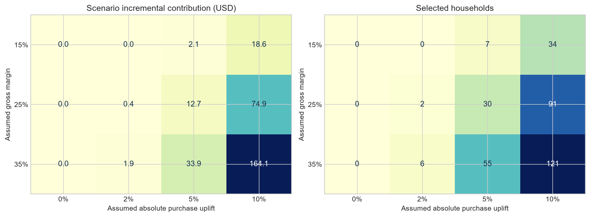

# Main analysis: purchase behaviour and a hypothetical CRM offer

## Business boundary

The intended decision is which household should receive which coupon. Current code delivers purchase-history analysis, RFM, no-purchase risk and audience selection for **one hypothetical USD 2 offer**. It does not assign actual COUPON_UPC values, identify causal offer response, or establish optimal coupon-specific profit. Previous six-stage completion wording described technical modules too broadly for this business decision.

## What the main analysis establishes

- Data definitions, keys, missingness and receipt consistency are audited in notebook 01.
- Full-window eligible retailer sales are USD 8,057,443.80 from 275,539 paid baskets and 2,500 purchasing households. Eligibility excludes non-positive quantity/sales lines, with explicit reconciliation.
- Notebook 03 explores aggregate categories and discount use. Household-specific category preferences are still needed.
- Notebook 04 provides interpretable RFM labels; they describe purchase history rather than coupon responsiveness.
- Selected no-purchase model: random_forest; frozen-test average precision 0.5446, ROC AUC 0.8731. This predicts non-purchase under historical promotion conditions, not a verified untreated counterfactual.
- Default hypothetical-offer scenario selects 91 households with maximum reserved cost USD 186.55 under budget USD 250.00. Scenario incremental contribution USD 74.92 depends on assumed uplift/margin and a baseline-probability proxy; it is not realised campaign impact.

## CRM purchase-value scenario

The default scenario compares the same 91 selected households over a 30-day horizon. It uses the predicted purchase probability under historical promotion conditions as the baseline proxy (`p0`) and adds an assumed 10 percentage points, capped at 100%, for the coupon scenario (`p1`). Both calculations value a purchase using the household's historical 180-day average basket value.

| Quantity | Calculation across selected households | USD |
|---|---|---:|
| Expected baseline purchase value | Sum of `p0 × average_basket_180` | 3,728.00 |
| Expected additional purchase value before campaign costs | Sum of `(p1 − p0) × average_basket_180` | 746.31 |
| Expected coupon and contact costs | Sum of `p1 × 2.00 + 0.05` | 111.66 |
| Expected additional purchase value after campaign costs | Additional purchase value minus expected campaign costs | 634.65 |

Dividing USD 634.65 by USD 3,728.00 gives **17.0%**. The values can be reproduced from `data/processed/portfolio/crm_targets.csv` using `p0_purchase`, `assumed_p1_purchase`, `average_basket_180`, and `expected_offer_cost_usd`. Applying the assumed 25% gross margin to the USD 746.31 before subtracting campaign costs gives the separate USD 74.92 incremental contribution estimate. A household-randomised pilot would be needed to measure the campaign's effect on sales. [CRM notebook](../notebooks/06_crm_campaign_scenarios.ipynb) · [Experiment plan](../docs/crm_experiment_plan.md)

## Main figures

See the [purchase/category gallery](visual_findings.md) for the earlier main figures. [Additional analysis](../additional/README.md) preserves retention, clustering, value scenarios and placements; these are not required inputs to current audience selection.

## Missing decision layer

Build household-category preferences, map actual coupons to eligible products/categories and validity windows, account for known exposures, generate household-coupon candidates, rank and budget those pairs, and evaluate against simple recommendation baselines. Unknown coupon costs and causal response must remain assumptions or experimental questions. Historical coupon redemption alone does not establish additional sales.

No dashboard workbook or customer campaign has been published/launched. The [Power BI](../powerbi/dashboard_plan.md) and [Tableau](../tableau/dashboard_plan.md) plans show the current scope and its open coupon-decision work explicitly.
