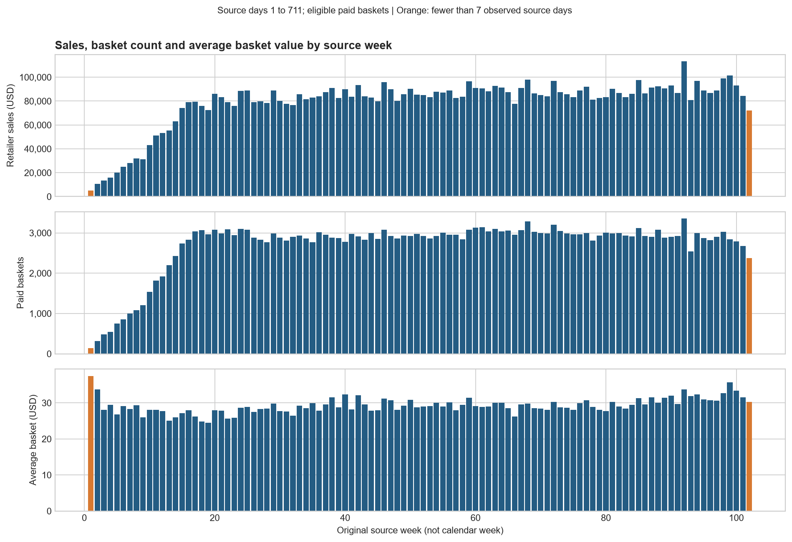
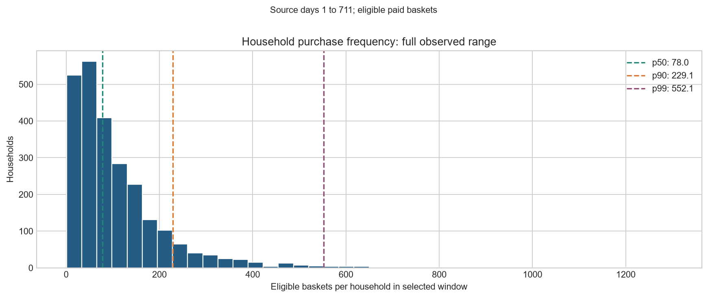
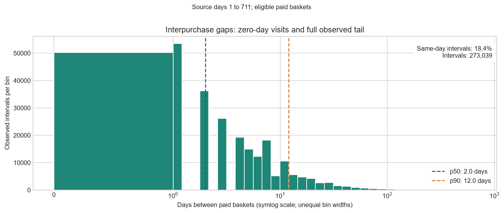
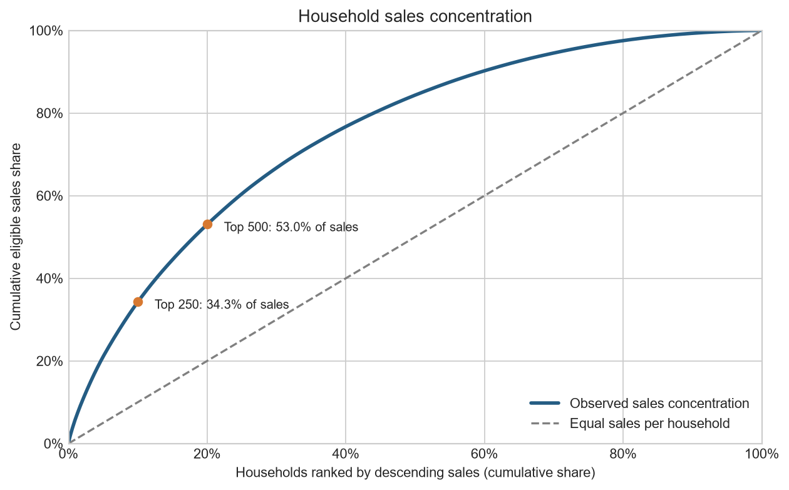
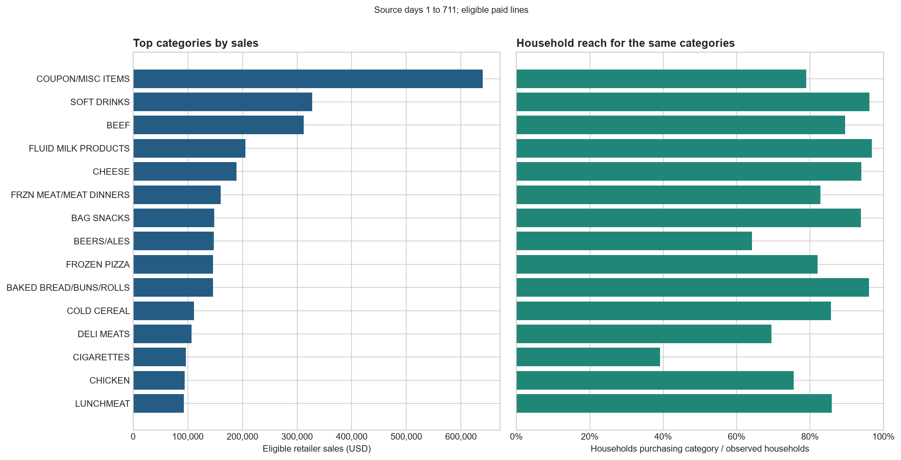
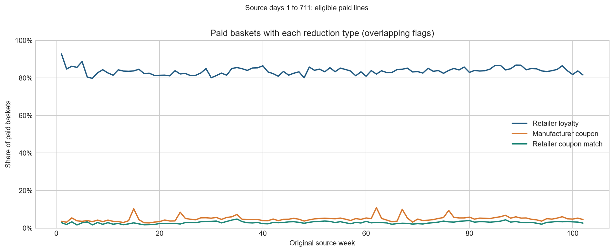
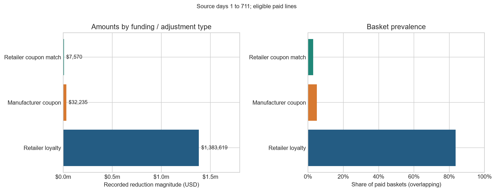

# Visual exploration: household behaviour, categories and discounts

Snapshot: source days 1 to 711, using positive-quantity, positive-sales lines. These are descriptive results, not experimental campaign effects. The seven main charts are generated by the executed notebooks; local aggregate datasets remain excluded from Git.

## Household and time patterns

- Median household frequency is 78 paid baskets across the full window; the mean is higher because the distribution is right-skewed.
- The highest-spending 250 households (10%) account for 34.29% of eligible sales; the highest-spending 500 (20%) account for 53.05%.
- Weekly totals show a source-period ramp-up. Calendar seasonality, acquisition, or marketing impact cannot be inferred from that pattern alone. Edge weeks with fewer than seven observed days are marked separately.
- Consecutive-basket gaps include same-day receipts and exclude intervals across observation boundaries. These are not churn probabilities.

## Categories and discounts

- The largest source category is `COUPON/MISC ITEMS`, contributing 7.94% of eligible sales. Mixed source labels need investigation before merchandising interpretation.
- Household category reach overlaps across categories. The chart is a top-15 view; complete aggregate tables are generated locally.
- Discount basket flags overlap. Negative signed adjustments are presented as reduction magnitudes; positive adjustments are reported separately. Manufacturer-funded and retailer-funded reductions are distinct concepts and not a single retailer campaign cost.

## Reading scope

Read [customer metrics](../notebooks/02_customer_metrics.ipynb) and [category/discount EDA](../notebooks/03_categories_and_discounts.ipynb). Placement coverage and its chart are preserved in the [additional report](../additional/reports/full_visual_findings.md). These figures are descriptive context; specific household-coupon pairing remains unimplemented.
